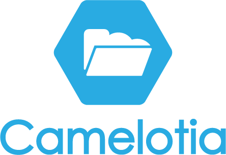
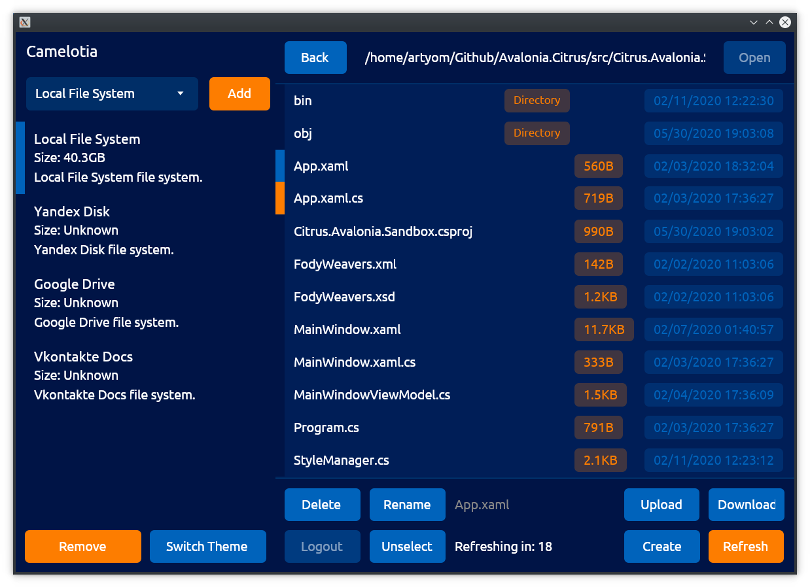
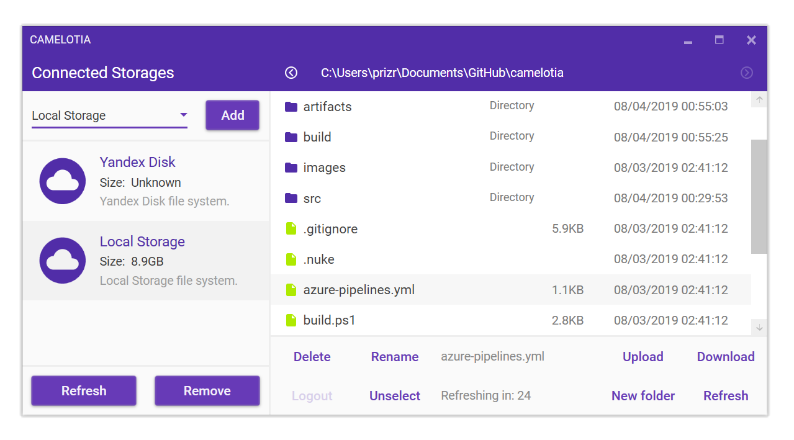

<div align="center">

<a href="https://github.com/reactiveui/Camelotia"></a>

# Camelotia: A cloud storage file manager built with ReactiveUI

[](https://github.com/reactiveui/Camelotia/actions/workflows/ci-build.yml)
[](https://codecov.io/gh/reactiveui/Camelotia)
[](https://github.com/reactiveui/Camelotia/blob/main/LICENSE)
[](https://github.com/reactiveui/Camelotia/discussions)

</div>

Camelotia is a file manager for cloud storage, built with [ReactiveUI](https://github.com/reactiveui/ReactiveUI) and modern .NET UI frameworks. It browses, uploads, downloads, renames and deletes files in Yandex Disk, Google Drive, VK Documents, GitHub, FTP, SFTP and the local file system.

The same view models drive an [Avalonia](https://github.com/AvaloniaUI/Avalonia) app for Windows, Linux and macOS, and a WPF app for Windows. Both target .NET 10 and .NET 11.

| Avalonia | WPF |
| -------- | --- |
|  |  |

## Build and run

Install the [.NET 11 SDK](https://dot.net/). Run these commands from the `src` folder.

```sh
# Build the Avalonia app, the shared libraries and the tests.
dotnet build Camelotia.Avalonia.slnf

# Run the Avalonia app.
dotnet run --project Camelotia.Presentation.Avalonia --framework net11.0

# Run the tests. Add the flags after "--" to collect Cobertura coverage.
dotnet test --project Camelotia.Tests -- --coverage --coverage-output-format cobertura
```

The WPF app builds on Windows with `dotnet build Camelotia.Wpf.slnf`. Its views use plain XAML and reactive bindings, so you can copy a view and its view model into your own WPF app.

## Signing in to each provider

| Provider | How you sign in | What to set up |
| -------- | --------------- | -------------- |
| Local | No sign-in. | Nothing. |
| FTP and SFTP | Address, port, user name and password. | Nothing. The SFTP client accepts any host key. |
| GitHub | Your user name, with a [personal access token](https://github.com/settings/tokens) as the password. | Give the token read and write access to the repositories you want to browse. |
| Google Drive | In the browser. | The Google client ID and secret are in `GoogleDriveCloudOptions`. |
| Yandex Disk | In the browser, with PKCE. | Register `http://127.0.0.1:3000/` as the redirect URI of the Yandex OAuth app in `YandexDiskCloudOptions`. |
| VK Documents | In the browser, through VK ID with PKCE. | Register `http://127.0.0.1:3001/` as a trusted redirect URL of the VK ID app in `VkDocsCloudOptions`. VK must also give that app access to the documents API. |

The browser providers open your default browser, then wait on the loopback address for the redirect. The app's settings live in `CloudConfiguration`, which the app saves with the rest of its state.

## How it is built

- `Camelotia.Services` holds one `ICloud` provider for each service. The Yandex Disk and VK clients are [Refit](https://github.com/reactiveui/refit) interfaces with source-generated code and source-generated JSON, registered through `AddCloudServices()`.
- `Camelotia.Presentation` holds the view models. They are written with [ReactiveUI.SourceGenerators](https://github.com/reactiveui/ReactiveUI.SourceGenerators), [ReactiveUI.Validation](https://github.com/reactiveui/ReactiveUI.Validation) and [DynamicData](https://github.com/reactivemarbles/DynamicData).
- ReactiveUI's typed suspension saves the app state to [Akavache](https://github.com/reactiveui/Akavache) with System.Text.Json.
- The tests use [TUnit](https://github.com/thomhurst/TUnit) on Microsoft.Testing.Platform. They run the real Refit, Octokit and Google clients against stubbed HTTP handlers, so no test talks to a real service.

## Technologies

- [ReactiveUI](https://reactiveui.net/) and [ReactiveUI.Primitives](https://github.com/reactiveui/Primitives) for observable state, commands and view activation
- [ReactiveUI.SourceGenerators](https://github.com/reactiveui/ReactiveUI.SourceGenerators) for reactive properties
- [ReactiveUI.Validation](https://github.com/reactiveui/ReactiveUI.Validation) for form validation
- [DynamicData](https://github.com/reactivemarbles/DynamicData) for reactive collections
- [Akavache](https://github.com/reactiveui/Akavache) for the persistent key-value store
- [Refit](https://github.com/reactiveui/refit) for the Yandex Disk and VK REST clients
- [Avalonia](https://github.com/AvaloniaUI/Avalonia) with the Fluent theme for the cross-platform app
- [Material Design in XAML](https://github.com/MaterialDesignInXAML/MaterialDesignInXamlToolkit) and [MahApps.Metro](https://github.com/MahApps/MahApps.Metro) for the WPF app
- [Octokit](https://github.com/octokit/octokit.net) for GitHub
- [Google APIs Client Library](https://github.com/googleapis/google-api-dotnet-client) for Google Drive
- [FluentFTP](https://github.com/robinrodricks/FluentFTP) for FTP
- [SSH.NET](https://github.com/sshnet/SSH.NET) for SFTP
- [TUnit](https://github.com/thomhurst/TUnit) and Microsoft.Testing.Platform for tests and coverage

## Contribute

Camelotia is part of [ReactiveUI](https://github.com/reactiveui) and is released under the [MIT license](https://github.com/reactiveui/Camelotia/blob/main/LICENSE). We welcome contributions of every size, from bug reports and documentation to features and tests.

- **Questions:** ask in [GitHub Discussions](https://github.com/reactiveui/Camelotia/discussions).
- **Bugs and feature requests:** open a [GitHub issue](https://github.com/reactiveui/Camelotia/issues/new/choose).
- **Larger changes:** open an issue or discussion first, so we can agree on the approach before you start.
- **Contributor guide:** read [reactiveui.net/contribute](https://www.reactiveui.net/contribute/) for [building and testing](https://www.reactiveui.net/contribute/building-and-testing/) and [pull requests](https://www.reactiveui.net/contribute/pull-requests/).

### Coding standards

Every pull request must meet these standards. The build checks most of them.

- Follow the [ReactiveUI C# style guide](https://www.reactiveui.net/contribute/software-style-guide/code-style/).
- The repository's `.editorconfig` and the StyleSharp, PerformanceSharp and SecuritySharp analyzers run on every build. Fix each finding in the code. Do not suppress it or relax the `.editorconfig`.
- Add tests for every bug fix and new feature.
- Document public APIs with XML documentation comments.
- Write commit messages in the [Conventional Commits](https://www.reactiveui.net/contribute/software-style-guide/commit-message-convention/) format.
- Follow the [Code of Conduct](https://github.com/reactiveui/.github/blob/main/CODE_OF_CONDUCT.md).

### Support the project

- Sponsor the maintainers on GitHub Sponsors: [reactivemarbles](https://github.com/sponsors/reactivemarbles), [glennawatson](https://github.com/sponsors/glennawatson) and [chrispulman](https://github.com/sponsors/chrispulman).
- Ask your employer to support open source, for example with the [balanced employee IP agreement](https://github.com/github/balanced-employee-ip-agreement).

## Sponsors

[JetBrains](https://www.jetbrains.com/) gives ReactiveUI's maintainers licences for its tools through its
[open source support programme](https://www.jetbrains.com/community/opensource/).
[Anthropic](https://www.anthropic.com/) supports them with [Claude](https://claude.com/) through
[Claude for Open Source](https://claude.com/contact-sales/claude-for-oss).
[OpenAI](https://openai.com/) supports them with [Codex](https://openai.com/codex/) through
[Codex for Open Source](https://developers.openai.com/community/codex-for-oss).
[Snyk](https://snyk.io/) gives the maintainers access to security tools through its
[Secure Developer Program](https://snyk.io/open-source/).

[](https://www.jetbrains.com/)
[](https://claude.com/)
[](https://openai.com/codex/)
[](https://snyk.io/)

See [our sponsors](https://www.reactiveui.net/sponsors/) for more information.
JetBrains, Claude, Anthropic, OpenAI and Codex names and logos are trademarks of their respective owners.
Snyk and the Snyk logo are trademarks of Snyk Ltd.
